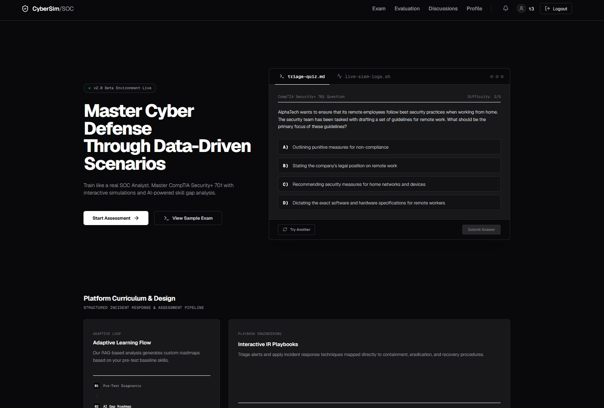
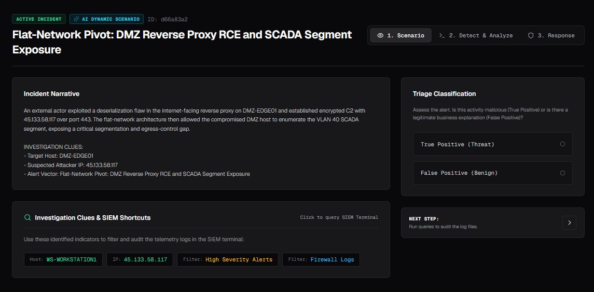
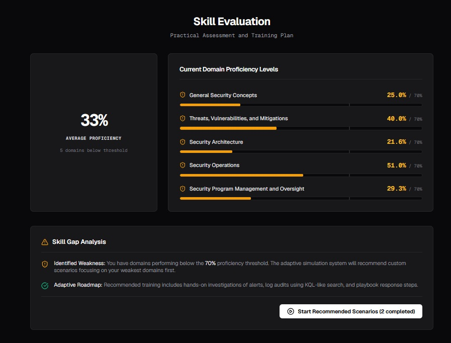

# Automated Data-Driven Cyberattack Simulation for Blue Team Training

This is a Senior Project for Computer Engineering, Kasetsart University.

This project implements an interactive platform designed to train and assess Blue Teams (defense) through automated, data-driven cyberattack simulations. It features a robust assessment pipeline containing user authentication, randomized Pre/Post tests across core security domains, session state recovery, and analytics dashboards.

---

## 📸 Interface Preview

### Landing Page


The landing page introduces the platform with the CyberSim/SOC brand and the tagline **"Master Cyber Defense Through Data-Driven Scenarios."** It offers two entry points — **Start Assessment** and **View Sample Exam** — and previews a CompTIA Security+ SY0-701 practice question inside a terminal-style panel. Below the hero, the *Platform Curriculum & Design* section presents the **Adaptive Learning Flow** (pre-test diagnostic → AI gap roadmap) and **Interactive IR Playbooks** mapped to containment, eradication, and recovery.

### Scenario Investigation Workspace


The simulation workspace for an active incident. The header shows the scenario title, generation source (AI Dynamic Scenario or static fallback), and session ID, with three-step navigation: **1. Scenario → 2. Detect & Analyze → 3. Response**. The first panel presents the incident narrative, a **Triage Classification** control for True Positive vs. False Positive, and clickable **Investigation Clues & SIEM Shortcuts** that pre-fill queries against the telemetry logs.

### Skill Evaluation Dashboard


The post-assessment dashboard summarizes learner performance against the **70% proficiency threshold**. It shows the average proficiency score, per-domain proficiency bars for all five CompTIA Security+ domains, and a **Skill Gap Analysis** that identifies the weakest domains and recommends adaptive hands-on scenarios covering log investigation, KQL search, and playbook response.

---

## 🚀 Core Features

- **Pre-Test & Post-Test Assessment**: Automated evaluation of learner skills using 100-question randomized exams. Questions are dynamically drawn from 5 distinct CompTIA Security+ domains:
  - **Domain 1**: Security Concepts (12 questions)
  - **Domain 2**: Threats, Vulnerabilities, and Mitigations (22 questions)
  - **Domain 3**: Security Architecture (18 questions)
  - **Domain 4**: Security Operations (28 questions)
  - **Domain 5**: Security Management (20 questions)
- **Zero Question Overlap**: The randomization engine ensures that questions presented in the user's Pre-Test are strictly excluded from their Post-Test.
- **Session Recovery**: State-persisted exam sessions ensure that user progress is saved. If a network disconnection or page refresh occurs, the active session is recovered automatically.
- **Data Ingestion Pipeline**: Deterministic markdown-to-JSON parser that parses CompTIA exam questions and automatically seeds security domains and questions into the database.
- **Analytics & Skill Gaps**: Interactive evaluation dashboards utilizing radar charts to display proficiency across the five security domains.

---

## 🛠️ Technology Stack

- **Backend**: Go (version 1.25), Gin Web Framework, GORM (Object-Relational Mapping)
- **Frontend**: React, Vite, TypeScript, Tailwind CSS, Recharts
- **Database**: PostgreSQL 16 with `pgvector` & `pgcrypto` extensions
- **Infrastucture**: Docker & Docker Compose

---

## 📂 Project Structure

```text
├── controllers/          # Go backend controllers (Auth, Exam controllers)
├── models/               # GORM database schemas & struct definitions
├── middlewares/          # JWT authentication middleware
├── frontend/             # React (Vite) frontend application
│   ├── src/
│   │   ├── pages/        # Dashboard, Exam, Evaluation, and Landing pages
│   │   └── components/   # Shared UI components
│   └── Dockerfile        # Frontend Docker configuration
├── examination/          # CompTIA Security+ markdown source exam files
├── scripts/              # Python automation & testing scripts
│   ├── parse_exams.py    # Parses markdown exams to JSON
│   ├── load_exams_to_db.py # Seeds security domains and inserts questions
│   └── test_integration.py # End-to-end integration test suite
├── init.sql              # Database initialization schema (tables, types, indexes)
├── Dockerfile            # Backend Docker configuration
└── docker-compose.yml    # Multi-container service configuration
```

---

## ⚙️ Quick Setup & Deployment (Linux, macOS & Windows)

No host **Go**, **Node.js**, or **Python** installation is required—everything (PostgreSQL `pgvector`, deterministic seeding, backend API, React frontend, and optional Cloud Auto-HTTPS) runs cleanly via **Docker Compose**.  
Full specification: [workflows/cross_platform_setup.md](workflows/cross_platform_setup.md).

### Option A — Bare Machine / Fresh Cloud VM (Not Cloned Yet)

- **Linux (Ubuntu/Debian `apt`, RHEL/Alma/Rocky/Fedora `dnf`/`yum`, Amazon Linux 2023) & macOS:**
  ```bash
  # Interactive wizard (or add --non-interactive --mode cloud --domain soc.example.com --auto-deps)
  curl -fsSL https://raw.githubusercontent.com/balliolon2/Automated_Data-Driven_Cyberattack_Simulation_for_Blue_Team_Training/main/scripts/bootstrap.sh | bash
  ```
- **Windows 10/11 / Server (PowerShell 5.1+ / 7+ with Docker Desktop WSL2):**
  ```powershell
  irm https://raw.githubusercontent.com/balliolon2/Automated_Data-Driven_Cyberattack_Simulation_for_Blue_Team_Training/main/scripts/bootstrap.ps1 | iex
  ```
  *(Pass `-AutoDeps` / `--auto-deps` if Git or Docker Desktop needs installation via `winget`; if Windows prompts to reboot after WSL2 setup, reboot and re-run.)*

### Option B — From an Existing Clone

- **Linux / macOS (`install.sh`):**
  ```bash
  chmod +x install.sh
  ./install.sh                  # Interactive menu
  ./install.sh install --mode local
  ./install.sh install --mode cloud --domain soc.example.com --acme-email admin@example.com
  ```
- **Windows (`install.bat` / `install.ps1` — bypasses ExecutionPolicy automatically):**
  ```powershell
  .\install.bat                 # Double-click or run for interactive menu
  .\install.bat install --mode local
  .\install.bat install --mode cloud --domain soc.example.com --acme-email admin@example.com
  ```

### Supported Subcommands (Linux & Windows Parity)

| Command | Behavior |
| :--- | :--- |
| `install` | Preflight checks, CSPRNG `.env` generation + permission lockdown (`chmod 600` / `icacls`), containerized `db -> seed -> backend -> frontend` (+ Caddy HTTPS if Cloud domain), and non-polluting smoke verification (DB counts + `/api/health` + Admin login) |
| `check` | Read-only preflight audit (OS/WSL2, Docker/Compose, RAM/disk, ports, `.env`, LF/CRLF hygiene) |
| `status` | Active deployment mode, public URL, Cloud TLS state, redacted LLM mode, and `docker compose ps` |
| `seed` / `check-seed` | Run idempotent Docker seeding (`5` domains, `540` questions, `28` subtopics, `33` TH docs, `15` scenarios) or read-only count verification |
| `backup` | Writes timestamped `.sql.gz` DB dump + `uploads` volume `.tar.gz` to `backups/` (retains newest 10 sets) |
| `restore <file>` | Typed `RESTORE` guard + pre-restore safety backup + restores DB and matching uploads archive |
| `update` | Auto-backup + optional `git pull --ff-only` (`--no-pull`) + rebuild/re-seed + health check |
| `logs [service]` | Stream Docker Compose container logs |
| `uninstall` | Stops & removes containers while keeping persistent volumes (`--volumes` requires typed `DELETE DATA`) |
| `reset-dev-data` | Local-only runtime table wipe + re-seed (**strictly refused** when `APP_ENVIRONMENT=cloud`) |

### Cloud Security & Optional Daily Backups

- **Cloud HTTPS (`docker-compose.cloud.yml` + `Caddyfile.template`):** Passing `--mode cloud --domain <hostname>` configures Caddy (`80/443`, Let's Encrypt), persists `COMPOSE_FILE=docker-compose.yml:docker-compose.cloud.yml` and `COMPOSE_PATH_SEPARATOR=:` inside `.env`, and sets `FRONTEND_URL=https://<hostname>`. Without a domain, Cloud mode runs HTTP `:80` with a clear TLS warning.
- **Firewall Baseline:** Only ports `80/tcp` and `443/tcp` (plus restricted `SSH`/`RDP`) should be open publicly; `5432`, `8080`, and `5050` remain isolated. Installers inspect ports without modifying firewall rules unless `--configure-firewall` is passed explicitly.
- **Optional Developer E2E Verification (`--mode local` only):** Pass `--verify-e2e` (or run `python scripts/test_integration.py`) only in local dev environments; never run synthetic test scripts against live research databases. Cross-OS setup contract suite: `python scripts/test_cross_platform_setup.py`.
- **Optional Manual Daily Backup Schedule Examples:**
  - Linux `crontab -e`: `0 2 * * * cd /path/to/repo && ./install.sh backup --non-interactive >/var/log/cybersim-backup.log 2>&1`
  - Windows Task Scheduler: `schtasks /create /tn "CyberSimBackup" /tr "cmd /c cd /d C:\path\to\repo && .\install.bat backup --non-interactive" /sc daily /st 02:00`

---

## 🚀 CI/CD & DevSecOps Automation (Zero-Cost)

The project includes an enterprise-grade automated CI/CD pipeline on GitHub Actions at zero hosting expense:

1. **Continuous Integration (`.github/workflows/ci.yml`)**:
   - Runs automatically on Pull Requests and pushes to `main`.
   - **Lint & Code Quality**: `go vet ./...`, TypeScript `tsc -b`, and ESLint.
   - **DevSecOps Security Gate**: Gitleaks (secret scanning), `govulncheck` (Go CVE vulnerability scan), and `npm audit --audit-level=high`.
   - **Integration Test Harness**: Spins up ephemeral `pgvector/pgvector:pg16` service container, seeds exam data via `scripts/load_exams_to_db.py`, launches the Go API, and asserts test logic with `scripts/test_integration.py`.
   - **Build Validation**: Validates Docker backend build and Vite frontend production bundle.

2. **Continuous Delivery (`.github/workflows/cd.yml`)**:
   - Triggers on push/merge to `main`.
   - Deploys Go backend container to Render Free Web Service via Deploy Hook.
   - Deploys React frontend SPA to Cloudflare Pages.

3. **Cold-Start Liveness Worker (`.github/workflows/keep_alive.yml`)**:
   - Scheduled cron every 14 minutes pings `/api/health` to prevent free-tier container hibernation.

### GitHub Repository Secrets (Optional for Deployment)
| Secret Name | Description |
| :--- | :--- |
| `RENDER_DEPLOY_HOOK_URL` | Webhook URL from Render Web Service Settings to trigger redeploy |
| `RENDER_BACKEND_URL` | Public API URL for keep-alive worker (defaults to `https://soc-trainer-api.onrender.com/api/health`) |
| `VITE_API_URL` | Production Backend API URL for frontend build |
| `CLOUDFLARE_API_TOKEN` | (Optional) Cloudflare API token if using Wrangler Action |
| `CLOUDFLARE_ACCOUNT_ID` | (Optional) Cloudflare Account ID if using Wrangler Action |

---

## 📚 References

- [docs/REFERENCES.md](docs/REFERENCES.md) — Central reference registry (R-ID), APA 7th / BibTeX citations, question-bank provenance, and copyright restrictions
- [examination/README.md](examination/README.md) — Source exam file documentation, chapter → Domain mapping, and the parser-generated artifact policy
