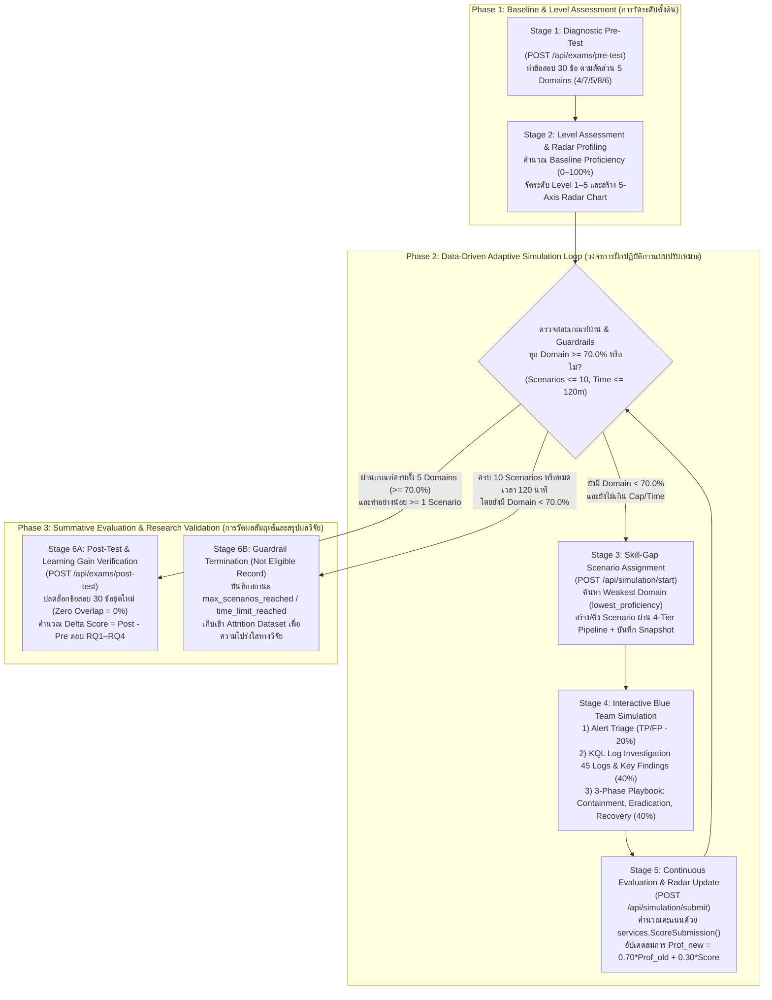

# สรุปการตอบข้อเสนอแนะจากอาจารย์ที่ปรึกษา: Research Questions (RQ), Level Assessment, Radar Chart (25 Possibilities) และ Adaptive Learning Path

เอกสารฉบับนี้จัดทำขึ้นเพื่อตอบคำถามและข้อเสนอแนะจากการนำเสนอความก้าวหน้าโครงงาน (Presentation Feedback) สำหรับระบบ **Automated Data-Driven Cyberattack Simulation for Blue Team Training** โดยอ้างอิงจากสถาปัตยกรรมจริงใน Codebase (`services/evaluator.go`, `controllers/simulation_controller.go`, `controllers/exam_controller.go`) และสัญญาการวิจัย (`docs/SCORING_AND_PROFICIENCY_CONTRACT.md`, `docs/ADAPTIVE_LOOP_STATE_MACHINE.md`, `docs/RESEARCH_PROTOCOL.md`, `docs/RESEARCH_EVALUATION_PLAN.md`)

---

## 1. [First Priority] Research Questions (RQ) & การตอบว่า Project ตอบได้ไหมด้วยตัวเลข (Y/N Decision Matrix)

### 1.1 กรอบการวิจัยเชิงพฤติกรรม (One-Group Pretest–Posttest Behavioral Design)

โครงงานนี้ใช้รูปแบบการทดลองแบบ **One-Group Pretest–Posttest Behavioral Design** เพื่อวัดพัฒนาการของผู้เรียนรายบุคคลและรายกลุ่มผ่านกระบวนการ:

$$\text{Consent} \longrightarrow \text{Pre-Test (30 ข้อ)} \longrightarrow \text{Adaptive Simulation Loop (Skill-Gap Driven)} \longrightarrow \text{Post-Test (30 ข้อ คู่ขนาน)}$$

เพื่อให้การตอบคำถามอาจารย์ที่ปรึกษาชัดเจนและไม่สับสน จึงแยกการตอบแบบ **YES / NO (Y/N)** ออกเป็น **2 มิติ** ที่ตรวจสอบได้ด้วยตัวเลขจริงในระบบ:
1. **มิติที่ 1: System Measurement Readiness (ความพร้อมของระบบและฐานข้อมูลในการวัดผล)** — ระบบสามารถเก็บตัวแปร คำนวณคะแนน และส่งออกข้อมูลผ่าน API (`GET /api/analytics/research-summary`) เพื่อตอบ RQ ข้อนั้นได้แล้วหรือไม่? $\rightarrow$ **คำตอบคือ YES (100% ทุกข้อ)**
2. **มิติที่ 2: Empirical Research Answer (เกณฑ์ตัดสิน Y/N ทางสถิติเมื่อเก็บข้อมูลจากกลุ่มตัวอย่างจริง)** — กำหนดเกณฑ์ตัวเลข (Quantitative Cut-off Criteria) ล่วงหน้าอย่างชัดเจนว่า ผลลัพธ์จากการทดลองจะต้องมีค่าเท่าใดจึงจะสรุปผลวิจัยว่า **YES (สนับสนุนสมมติฐาน)** หรือ **NO (ปฏิเสธสมมติฐาน)**

---

### 1.2 ตารางสรุป Research Questions (RQ1–RQ4) และเกณฑ์ตัดสิน Y/N ด้วยตัวเลข

| รหัส | คำถามวิจัย (Research Question) | ตัวแปรและสูตรที่วัดในระบบ (Codebase Metric) | เกณฑ์ตัดสิน **YES (Y)** เมื่อเก็บข้อมูลจริง (Empirical Criteria) | เกณฑ์ตัดสิน **NO (N)** เมื่อเก็บข้อมูลจริง | ความพร้อมของระบบในการวัดผล (System Readiness) |
| :--- | :--- | :--- | :--- | :--- | :---: |
| **RQ1 (Primary RQ)** | **Learning Gain Effectiveness:** ผู้เรียนที่ผ่านกระบวนการ *Pre-test $\rightarrow$ Adaptive Cyberattack Simulation $\rightarrow$ Post-test* มีผลสัมฤทธิ์ทางการเรียนหลังการฝึกสูงกว่าก่อนการฝึกอย่างมีนัยสำคัญทางสถิติหรือไม่? | - $\Delta \text{Score} = \text{Post-test} - \text{Pre-test}$ - ข้อสอบคู่ขนานฝั่งละ `30` ข้อ ตามสัดส่วน CompTIA Security+ (`4 / 7 / 5 / 8 / 6` ข้อ) - บังคับ `NOT IN (pre_test_questions)` (Zero Question Overlap = `0%`) | **ตอบ YES (Y) เมื่อครบทั้ง 3 เงื่อนไข:** 1. $\overline{\Delta \text{Score}} > 0$ (ค่าเฉลี่ยคะแนน Post-test สูงกว่า Pre-test) 2. การทดสอบ **Paired t-test** (หรือ **Wilcoxon signed-rank test**) ให้ค่า $p\text{-value} < 0.05$ 3. ขนาดอิทธิพล (**Effect Size: Cohen's $d$**) $\ge 0.50$ (ระดับ Medium ขึ้นไป) | **ตอบ NO (N) เมื่อ:** - $\overline{\Delta \text{Score}} \le 0$ **หรือ** - $p\text{-value} \ge 0.05$ (ความแตกต่างไม่มีนัยสำคัญทางสถิติ) | **YES (100%)** (`exam_sessions`, `exam_session_questions`, `GET /api/analytics/research-summary`) |
| **RQ2 (Sub-RQ 1)** | **Adaptive Skill-Gap Closure:** กลไกการเลือกสถานการณ์จำลองแบบ Data-Driven ที่มุ่งเป้าไปยังโดเมนที่ผู้เรียนมีคะแนนต่ำสุด (`lowest_proficiency`) สามารถยกระดับความสามารถ (`Proficiency Score`) ของผู้เรียนให้ผ่านเกณฑ์มาตรฐาน $\ge 70.0\%$ ครบทั้ง 5 โดเมน ภายในขอบเขต Guardrail ($\le 10$ Scenarios และ $\le 120$ นาที) ได้หรือไม่? | - อัปเดตคะแนนด้วยสมการถ่วงน้ำหนัก: $\text{Prof}_{\text{new}} = 0.70 \times \text{Prof}_{\text{old}} + 0.30 \times \text{Score}_{\text{scenario}}$ - ตรวจสอบ `ProficiencyThreshold = 70.0` ทุกโดเมน - บันทึก `completion_reason` (`all_domains_passed`, `max_scenarios_reached`, `time_limit_reached`) | **ตอบ YES (Y) เมื่อ:** 1. ผู้เรียนในกลุ่มตัวอย่างสามารถปิด Skill Gap จนทุกโดเมนมีค่า $\ge 70.0\%$ (`eligible_for_post_test = true`) ภายใน $\le 10$ Scenarios ($\overline{N}_{\text{scenarios}} \le 10$, $\overline{T} \le 120$ นาที) 2. คะแนนเฉลี่ยของโดเมนที่เป็นจุดอ่อนตั้งต้น (`weakest_domain`) เพิ่มขึ้นอย่างมีนัยสำคัญ ($p < 0.05$) | **ตอบ NO (N) เมื่อ:** - ผู้เรียนส่วนใหญ่ติดเพดาน `max_scenarios_reached` (10 ครั้ง) หรือ `time_limit_reached` (120 นาที) โดยที่ยังมีโดเมน $< 70.0\%$ (`not_eligible_for_post_test` / Attrition Dataset) | **YES (100%)** (`user_skill_profiles`, `services/evaluator.go`, `controllers/simulation_controller.go`) |
| **RQ3 (Sub-RQ 2)** | **Behavioral SOC Competency Progression:** ผู้เรียนมีพัฒนาการเชิงพฤติกรรมในการปฏิบัติงานของ Blue Team ทั้ง 3 มิติ ได้แก่ การคัดกรองแจ้งเตือน (Alert Triage), การสืบสวนหาหลักฐานจาก Log (Key Findings Discovery) และการเลือกขั้นตอนการตอบสนองตาม Playbook 3 ระยะ (Containment, Eradication, Recovery) ดีขึ้นตามลำดับการฝึกหรือไม่? | - คะแนนราย Scenario (`ScenarioResult`): $\text{Score} = 20\% \text{ Triage} + 40\% \text{ Findings} + 40\% \text{ Response}$ - บันทึกทุก Action ใน `session_actions` (`view_log`, `triage_alert`, `respond`, `submit_decision`) - ระบบให้คะแนน Playbook: เลือกถูก `+5` คะแนน, เลือกผิด (Penalty) `-3` คะแนน (ปัดพื้นไม่ต่ำกว่า `0`) | **ตอบ YES (Y) เมื่อ:** 1. ค่าเฉลี่ยคะแนนปฏิบัติการรวม ($\overline{\text{TotalScore}}$) $\ge 70.0\%$ 2. ความชันของเส้นแนวโน้มพัฒนาการ (Progression Slope $\beta$ จาก Scenario ครั้งที่ 1 ถึงครั้งที่ $k$) มีค่าเป็นบวก ($\beta > 0, p < 0.05$) และจำนวนการเลือก Playbook ที่ผิดพลาด (Penalty Actions) ลดลง | **ตอบ NO (N) เมื่อ:** - ความชัน $\beta \le 0$ (ทำหลาย Scenario แล้วคะแนนปฏิบัติการไม่เพิ่มขึ้น หรือยังสุ่มเดาตัวเลือกจนติด Penalty เท่าเดิม) | **YES (100%)** (`simulation_sessions.skill_gap`, `session_actions`, `services.ScoreSubmission()`) |
| **RQ4 (Sub-RQ 3)** | **Data-Driven Scenario Generation & Fallback Reliability:** สถาปัตยกรรมการสร้างและคัดเลือกสถานการณ์จำลองแบบ 4-Tier Pipeline (LLM/RAG Dynamic Generation $\rightarrow$ Static Pool Weakest Domain $\rightarrow$ Static Pool Secondary $\rightarrow$ Deterministic Synthesis Guarantee) สามารถส่งมอบสถานการณ์จำลองที่สมบูรณ์ (45 Telemetry Logs + 3-Phase Playbook) โดยไม่เกิดภาวะระบบหยุดชะงักได้ 100% หรือไม่? | - บันทึก `generation_type`, `fallback_reason`, `selection_reason` และ `validation_status` ในตาราง `scenario_snapshots` และ `simulation_sessions` - ตรวจสอบโครงสร้าง JSON (`initial_logs` = 45 รายการ, `expected_outcomes.key_findings`, `playbook_steps` 3 ระยะ) ภายใน `llm_max_retries = 2` | **ตอบ YES (Y) เมื่อ:** 1. อัตราการส่งมอบ Scenario ที่ผ่าน Schema Validation (`validation_status = 'valid'`) เท่ากับ **100.0%** ของการกดเริ่มฝึกทั้งหมด 2. อัตราการเกิด Session ล้มเหลว (`failure_class = 'system_failure'`) เท่ากับ **0.0%** | **ตอบ NO (N) เมื่อ:** - เกิด `scenario_unavailable` หรือ `system_failure` ($> 0\%$) ที่ทำให้ผู้เรียนไม่สามารถฝึกต่อได้ หรือได้ JSON ที่ไม่ครบ 3 Phases | **YES (100%)** (`scenario_snapshots`, `services/llm_generator.go`, `services/playbook_remediator.go`) |

---

## 2. Level Assessment (เกณฑ์การประเมินระดับความสามารถ 5 Levels)

เพื่อให้ผู้เรียนและผู้วิจัยสามารถตีความค่า `Proficiency Score` (`0.0% – 100.0%`) ในตาราง `user_skill_profiles` ได้อย่างเป็นรูปธรรมและสอดคล้องกับเกณฑ์ผ่าน `ProficiencyThreshold = 70.0%` ระบบจึงแบ่งระดับความสามารถ (Competency Levels) ออกเป็น **5 ระดับ (Level 1 – Level 5)** โดยผูกเข้ากับระดับความยากของสถานการณ์จำลอง (`scenario.Difficulty` Tier 1–5) ดังนี้:

### 2.1 ตารางนิยาม 5 Competency Levels และการจับคู่ความยากของ Scenario

| ระดับ (Competency Level) | ช่วงคะแนน (`Proficiency Score`) | สถานะเทียบเกณฑ์ (`Threshold = 70.0%`) | ความหมายเชิงปฏิบัติการด้านความมั่นคงปลอดภัย (Blue Team Operational Meaning) | ระดับความยากของ Scenario ที่ระบบจ่ายให้ (`Difficulty Tier`) |
| :--- | :---: | :---: | :--- | :---: |
| **Level 1: Novice (ระดับเริ่มต้น)** | `0.0% – 39.9%` | **ต่ำกว่าเกณฑ์มาก** *(Critical Skill Gap)* | ยังขาดความเข้าใจพื้นฐานในโดเมนนั้น ไม่สามารถจำแนกเหตุการณ์ปกติออกจากเหตุการณ์โจมตีได้ และยังเลือกขั้นตอนการตอบสนองไม่ถูกต้อง | **Tier 1 (Foundational):** โจมตีรูปแบบตรงไปตรงมา (Single-vector) มี Indicator ชัดเจนใน Log |
| **Level 2: Developing (ระดับกำลังพัฒนา)** | `40.0% – 54.9%` | **ต่ำกว่าเกณฑ์** *(Moderate Skill Gap)* | เข้าใจแนวคิดทฤษฎีบางส่วน สามารถคัดกรอง Alert เบื้องต้นได้ แต่ยังค้นหา Key Findings ใน Log ได้ไม่ครบถ้วน | **Tier 2 (Basic Operational):** มี Noise ปะปนใน Telemetry Logs ต้องใช้ตัวกรองค้นหาหลักฐาน |
| **Level 3: Intermediate (ระดับปานกลาง - ใกล้ผ่านเกณฑ์)** | `55.0% – 69.9%` | **เกือบผ่านเกณฑ์** *(Near-Threshold Gap)* | มีทักษะการสืบสวน Log ที่ดีขึ้น แต่ยังขาดความแม่นยำในการเลือก Playbook ครบทั้ง 3 ระยะ (Containment, Eradication, Recovery) หรือยังโดนหักคะแนนจากตัวหลอก | **Tier 3 (Standard SOC Analyst):** สถานการณ์จำลองระดับปฏิบัติการจริง มี Telemetry Logs 45 รายการ และตัวลวงใน Playbook |
| **Level 4: Proficient (ระดับเชี่ยวชาญตามเกณฑ์มาตรฐาน)** | `70.0% – 84.9%` | **ผ่านเกณฑ์มาตรฐาน** *(Passed / Eligible)* | **บรรลุเกณฑ์มาตรฐาน (`>= 70.0%`)** สามารถวิเคราะห์ Triage, สืบสวนหาหลักฐานจาก Log และเลือก Playbook ตอบสนองเหตุการณ์ได้อย่างถูกต้องตามหลัก CompTIA Security+ | **Tier 4 (Advanced Incident Responder):** การโจมตีหลายขั้นตอน (Multi-stage Attack) ที่เชื่อมโยงหลายระบบ |
| **Level 5: Mastery / Expert (ระดับเชี่ยวชาญสูง)** | `85.0% – 100.0%` | **สูงกว่าเกณฑ์อย่างโดดเด่น** *(Mastery)* | มีความแม่นยำสูงมากทั้งด้านทฤษฎีและปฏิบัติการ สามารถตรวจจับพฤติกรรมแฝง (Stealth / Living-off-the-Land) และตัดสินใจรับมือได้โดยไม่ติดตัวลวง | **Tier 5 (Expert Threat Hunter):** การโจมตีซับซ้อนระดับ APT ที่มีร่องรอยใน Log น้อยและต้องอาศัยการเชื่อมโยงข้ามโดเมน |

---

### 2.2 การแปลผลคะแนนจริงจากหน้าจอ (Screenshot Mapping ทั้ง 5 โดเมน)

จากภาพหน้าจอแสดงผล **Skill Radar Chart & Domain Proficiency** ของผู้เรียนในระบบ สามารถแปลงค่าเปอร์เซ็นต์ของแต่ละโดเมนเข้าสู่ระบบ **5 Competency Levels** และระบุลำดับความสำคัญในการฝึก (Adaptive Priority) ได้ดังนี้:

| ลำดับความเร่งด่วนในการฝึก (Adaptive Priority) | รหัสโดเมน (`domain_id`) | ชื่อโดเมนตามมาตรฐาน CompTIA Security+ (SY0-701) | คะแนนปัจจุบัน (จากหน้าจอ) | ระดับความสามารถที่ประเมินได้ (Assessed Level) | สถานะเทียบเกณฑ์ `70.0%` และคำอธิบายเชิงระบบ |
| :---: | :---: | :--- | :---: | :---: | :--- |
| **อันดับ 1 (Weakest Domain)** | `domain4` | **Security Operations** | **`70.4%`** | **Level 4 (Proficient)** | **ผ่านเกณฑ์แบบปริ่มเส้น (+0.4% เหนือเกณฑ์ 70.0%)** — เป็นโดเมนที่มีคะแนนต่ำที่สุดใน 5 โดเมน หากผู้เรียนกดฝึกต่อ ระบบ Adaptive (`lowest_proficiency`) จะเลือกจ่าย Scenario ของ **`domain4`** เป็นอันดับแรกเพื่อสร้างความมั่นคงของทักษะ |
| **อันดับ 2** | `domain1` | **General Security Concepts** | **`71.4%`** | **Level 4 (Proficient)** | **ผ่านเกณฑ์มาตรฐาน (+1.4% เหนือเกณฑ์ 70.0%)** — อยู่ในระดับเชี่ยวชาญขั้นต้น มีความเข้าใจหลักการ CIA Triad, Zero Trust และ Access Control |
| **อันดับ 3** | `domain5` | **Security Program Management and Oversight** | **`75.0%`** | **Level 4 (Proficient)** | **ผ่านเกณฑ์มาตรฐาน (+5.0% เหนือเกณฑ์ 70.0%)** — อยู่ในระดับเชี่ยวชาญ มีความเข้าใจด้าน Governance, Risk Management, Compliance และ Incident Reporting |
| **อันดับ 4** | `domain2` | **Threats, Vulnerabilities, and Mitigations** | **`90.9%`** | **Level 5 (Mastery)** | **ผ่านเกณฑ์ระดับสูงสุด (+20.9% เหนือเกณฑ์ 70.0%)** — เชี่ยวชาญสูงในการจำแนกภัยคุกคาม ช่องโหว่ และเทคนิคการโจมตีตามกรอบ MITRE ATT&CK |
| **อันดับ 5 (Strongest Domain)** | `domain3` | **Security Architecture** | **`94.6%`** | **Level 5 (Mastery)** | **ผ่านเกณฑ์ระดับสูงสุด (+24.6% เหนือเกณฑ์ 70.0%)** — เป็นโดเมนที่แข็งแกร่งที่สุดของผู้เรียน มีความเชี่ยวชาญด้านการออกแบบสถาปัตยกรรมและการแบ่งส่วนเครือข่าย (Network Segmentation) |

> **สรุปสถานะรวมของผู้เรียนจากภาพหน้าจอ:**
> - คะแนนเฉลี่ยรวม 5 โดเมน (`Average Proficiency`): $\frac{71.4 + 90.9 + 94.6 + 70.4 + 75.0}{5} = \mathbf{80.46\%}$ (**Level 4: Proficient**)
> - ทุกโดเมนมีค่า $\ge 70.0\%$ (`all_domains_passed = true`) จึงได้รับสถานะ **`eligible_for_post_test`** (ปลดล็อกสิทธิ์เข้าทำข้อสอบ Post-Test 30 ข้อ)
> - อย่างไรก็ตาม หากผู้เรียนต้องการยกระดับโดเมนที่อ่อนที่สุด (`Security Operations: 70.4%` หรือ `General Security Concepts: 71.4%`) ให้ขึ้นสู่ **Level 5 (Mastery $\ge 85.0\%$)** ผู้เรียนสามารถดู **Radar Chart** และทำตามแนวทางในหัวข้อที่ 3 ได้ทันที

---

## 3. Radar Chart & $5 \times 5 = 25$ Learning Possibilities ("อยากได้ Domain อะไร ต้องทำยังไง")

### 3.1 การอ่านองค์ประกอบทั้ง 3 ชั้นบน 5-Axis Radar Chart (Learning Possible Envelope)

บนหน้าจอ Dashboard ของระบบ กราฟเรดาร์ 5 แกน (5-Axis Radar Chart) ไม่ได้แสดงเพียงคะแนนปัจจุบันเท่านั้น แต่สามารถใช้อธิบาย **"ขอบเขตความเป็นไปได้ในการเรียนรู้ในก้าวถัดไป (Next-Step Learning Possible Envelope)"** จากสมการถ่วงน้ำหนักใน `services/evaluator.go` (`WeightOld = 0.70`, `WeightNew = 0.30`):

$$\text{Proficiency}_{\text{next}} = 0.70 \times \text{Proficiency}_{\text{current}} + 0.30 \times \text{Score}_{\text{scenario}}$$

เนื่องจากคะแนนสูงสุดที่ทำได้ใน 1 Scenario คือ $\text{Score}_{\text{scenario}} = 100.0\%$ ดังนั้น **เพดานคะแนนสูงสุดที่เป็นไปได้ในการฝึก Scenario ถัดไปเพียง 1 ครั้ง ($\text{Max Possible}_{\text{next}}$)** ของแต่ละแกนบน Radar Chart คือ:

$$\text{Max Possible}_{\text{next}} = 0.70 \times \text{Proficiency}_{\text{current}} + 30.0\%$$

จึงเกิดรูปหลายเหลี่ยม (Polygon) 3 ชั้นซ้อนกันบน Radar Chart ดังนี้:
1. **ชั้นที่ 1: Current Proficiency Polygon (เส้นทึบสีฟ้า/เขียวตามคะแนนจริง)** — แสดงระดับความสามารถปัจจุบันในทั้ง 5 โดเมน (เช่น `71.4%`, `90.9%`, `94.6%`, `70.4%`, `75.0%`)
2. **ชั้นที่ 2: Target Threshold Ring (เส้นประสีเหลืองอำพันที่ระดับ `70.0%` / ขอบเขตเริ่มต้นของ Level 4)** — แสดงเส้นมาตรฐานที่ทุกแกนต้องก้าวข้ามให้พ้นเพื่อปลดล็อก Post-Test
3. **ชั้นที่ 3: Next-Step Learning Possible Envelope (ขอบเขตศักยภาพสูงสุดใน 1 Scenario ถัดไป)** — แสดงให้ผู้เรียนเห็นว่า หากเลือกฝึกโดเมนนั้นในรอบถัดไปและทำคะแนนได้สมบูรณ์แบบ (`100%`) กราฟเรดาร์ของโดเมนนั้นจะขยายตัวออกไปได้สูงสุดถึงจุดใด:

| แกนบน Radar Chart (Domain Axis) | คะแนนปัจจุบัน ($\text{Prof}_{\text{current}}$) | ระดับปัจจุบัน | เพดานคะแนนสูงสุดใน +1 Scenario ถัดไป ($\text{Max Possible}_{\text{next}}$ เมื่อได้ 100%) | คะแนนที่เพิ่มขึ้นสูงสุดใน 1 รอบ ($\Delta \text{Max}$) | การเลื่อนระดับที่เป็นไปได้ (Level Transition) |
| :--- | :---: | :---: | :---: | :---: | :--- |
| **แกนที่ 1: General Security Concepts (`domain1`)** | `71.4%` | Level 4 | $0.70(71.4) + 30.0 = \mathbf{80.0\%}$ | `+8.6%` | ขยับจากต้น Level 4 ไปยังช่วงปลาย Level 4 (เข้าใกล้ Level 5) |
| **แกนที่ 2: Threats, Vulnerabilities, and Mitigations (`domain2`)** | `90.9%` | Level 5 | $0.70(90.9) + 30.0 = \mathbf{93.6\%}$ | `+2.7%` | สร้างความแม่นยำระดับสูงในกลุ่ม Level 5 (Mastery) |
| **แกนที่ 3: Security Architecture (`domain3`)** | `94.6%` | Level 5 | $0.70(94.6) + 30.0 = \mathbf{96.2\%}$ | `+1.6%` | รักษามาตรฐานสูงสุดในกลุ่ม Level 5 (Mastery) |
| **แกนที่ 4: Security Operations (`domain4`)** | `70.4%` | Level 4 | $0.70(70.4) + 30.0 = \mathbf{79.3\%}$ | `+8.9%` | **ขยายตัวได้มากที่สุด (+8.9%)** จากปริ่มเส้น `70.4%` ขึ้นสู่ระดับมั่นคง `79.3%` |
| **แกนที่ 5: Security Program Management (`domain5`)** | `75.0%` | Level 4 | $0.70(75.0) + 30.0 = \mathbf{82.5\%}$ | `+7.5%` | ขยับขึ้นใกล้เส้นแบ่ง Level 5 (`85.0%`) โดยขาดอีกเพียง `2.5%` |

---

### 3.2 ตาราง $5 \times 5 = 25$ Learning Possibilities Matrix (5 Domains $\times$ 5 Levels)

เมื่อนำ **5 โดเมนของ CompTIA Security+ (SY0-701)** มาคูณกับ **5 ระดับความสามารถ (Level 1 – Level 5)** จะได้พื้นที่สถานะการเรียนรู้ทั้งหมด **$5 \times 5 = 25$ Learning Possibilities (`[P1.1]` ถึง `[P5.5]`)** ซึ่งใช้เป็นแผนที่นำทาง (Competency Roadmap) ให้ผู้เรียนทราบว่าตนเองอยู่จุดใด และต้องปฏิบัติอย่างไรในแต่ละช่อง:

| โดเมน (CompTIA Security+ Domain) | **Level 1: Novice** (`0.0% – 39.9%`) | **Level 2: Developing** (`40.0% – 54.9%`) | **Level 3: Intermediate** (`55.0% – 69.9%`) | **Level 4: Proficient (Pass $\ge 70\%$)** (`70.0% – 84.9%`) | **Level 5: Mastery / Expert** (`85.0% – 100.0%`) |
| :--- | :--- | :--- | :--- | :--- | :--- |
| **Domain 1: General Security Concepts** *(สัดส่วนข้อสอบ: 4 ข้อ)* | **`[P1.1]`** ปูพื้นฐาน CIA Triad, AAA (Authentication, Authorization, Accounting) และ Non-repudiation | **`[P1.2]`** ฝึกแยกแยะประเภทของ Security Controls (Preventive, Detective, Corrective) จากเหตุการณ์เบื้องต้น | **`[P1.3]`** วิเคราะห์ความผิดปกติของกลไก Zero Trust, PKI Certificate และการปลอมแปลงสิทธิ์เข้าถึง | **`[P1.4]` 📍 [ตำแหน่งปัจจุบัน: `71.4%`]** คัดกรอง Alert ด้าน Identity/Access และเลือก Playbook เพิกถอนสิทธิ์/Token ได้ถูกต้อง | **`[P1.5]`** เชี่ยวชาญการตรวจสอบ Cryptographic Failure ซับซ้อนและวางมาตรการบังคับใช้ Least Privilege ครบวงจร |
| **Domain 2: Threats, Vulnerabilities, and Mitigations** *(สัดส่วนข้อสอบ: 7 ข้อ)* | **`[P2.1]`** รู้จักประเภทของ Malware, Social Engineering/Phishing และรูปแบบผู้โจมตีพื้นฐาน | **`[P2.2]`** ฝึกอ่าน Indicators of Compromise (IoCs) เบื้องต้น เช่น Malicious IP, Hash และ Domain ปลอม | **`[P2.3]`** สืบสวนช่องโหว่ (SQLi, XSS, Command Injection, Credential Stuffing) และจับคู่ MITRE ATT&CK | **`[P2.4]`** วิเคราะห์การโจมตีแบบลูกโซ่ (Kill Chain) ค้นหา Key Findings ครบ และเลือก Playbook ปิดช่องโหว่ได้แม่นยำ | **`[P2.5]` 📍 [ตำแหน่งปัจจุบัน: `90.9%`]** ตรวจจับพฤติกรรม APT/Zero-day exploitation และตัดวงจรการแพร่กระจายโดยไม่โดนตัวลวง |
| **Domain 3: Security Architecture** *(สัดส่วนข้อสอบ: 5 ข้อ)* | **`[P3.1]`** เข้าใจโครงสร้างเครือข่ายพื้นฐาน DMZ, Firewall, VPN และแนวคิด Defense-in-Depth | **`[P3.2]`** ตรวจสอบความผิดปกติของการตั้งค่า Network Zones, Cloud Security Groups และ WAF เบื้องต้น | **`[P3.3]`** วิเคราะห์เส้นทาง Lateral Movement ข้าม Subnet และระบุจุดอ่อนของสถาปัตยกรรมระบบ | **`[P3.4]`** ออกแบบการกักกันเครือข่าย (Network Isolation / Micro-segmentation) และกู้คืนระบบตามหลัก Resilience | **`[P3.5]` 📍 [ตำแหน่งปัจจุบัน: `94.6%`]** เชี่ยวชาญการวิเคราะห์ช่องโหว่เชิงสถาปัตยกรรมระดับ Enterprise/Cloud และการวางมาตรการ Hardening ถาวร |
| **Domain 4: Security Operations** *(สัดส่วนข้อสอบ: 8 ข้อ)* | **`[P4.1]`** ฝึกอ่านรูปแบบฟิลด์พื้นฐานของ SIEM Telemetry Logs (Timestamp, Source IP, EventID, Severity) | **`[P4.2]`** ฝึกใช้คำค้นหา (KQL / Log Filtering) เพื่อแยก True Positive (TP) ออกจาก False Positive (FP) | **`[P4.3]`** เชื่อมโยงเหตุการณ์ข้ามแหล่งข้อมูล (Sysmon, Firewall, EDR, Auth Logs) เพื่อระบุ Key Findings | **`[P4.4]` 📍 [ตำแหน่งปัจจุบัน: `70.4%` — จุดอ่อนที่สุด]** ปฏิบัติการ Incident Response ครบ 3 ระยะ (Containment, Eradication, Recovery) ตามมาตรฐาน SOC | **`[P4.5]`** ทำ Threat Hunting เชิงรุกจาก Log 45 รายการได้ครบ 100% พร้อมเลือก Playbook โดยไม่มี Penalty |
| **Domain 5: Security Program Management and Oversight** *(สัดส่วนข้อสอบ: 6 ข้อ)* | **`[P5.1]`** เข้าใจหลักการพื้นฐานของ Security Policy, Standard, Procedure และแนวคิดความเสี่ยง (Risk) | **`[P5.2]`** ระบุผลกระทบทางธุรกิจ (Business Impact) และความสำคัญของการจัดลำดับความรุนแรงเหตุการณ์ | **`[P5.3]`** เชื่อมโยงเหตุการณ์ละเมิดข้อมูลเข้ากับข้อกำหนดกฎหมาย (GDPR/PDPA, PCI-DSS, ISO 27001) | **`[P5.4]` 📍 [ตำแหน่งปัจจุบัน: `75.0%`]** เลือกขั้นตอนการแจ้งเตือนผู้เกี่ยวข้อง (Escalation), การเก็บรักษาหลักฐาน (Chain of Custody) และการทบทวนหลังเกิดเหตุ (Lessons Learned) | **`[P5.5]`** บูรณาการการจัดการความเสี่ยงระดับองค์กร การตรวจสอบ Compliance และการปรับปรุงนโยบายหลังเกิดเหตุได้อย่างสมบูรณ์ |

---

### 3.3 คู่มือปฏิบัติการ: "อยากได้คะแนนเพิ่มใน Domain อะไร จาก Radar Chart นี้ ต้องทำยังไง?" (3-Step Actionable Guide)

หากผู้เรียนมองดู Radar Chart แล้วตั้งคำถามว่า **"อยากดึงกราฟของ Domain ที่บุ๋มอยู่ให้พุ่งออกไปถึงเป้าหมาย ต้องทำอย่างไร?"** สามารถปฏิบัติตาม 3 ขั้นตอนที่มีสมการคณิตศาสตร์และกลไกของโค้ดรองรับชัดเจนดังนี้:

#### ขั้นตอนที่ 1: เลือกเป้าหมายจากจุดบุ๋มบน Radar Chart (Target Identification)
- มองหาแกนที่อยู่ใกล้จุดศูนย์กลางมากที่สุด หรือแกนที่ต้องการยกระดับ (เช่น จากภาพหน้าจอ แกนที่บุ๋มเข้ามามากที่สุดคือ **`domain4` (Security Operations = `70.4%`)** รองลงมาคือ **`domain1` (General Security Concepts = `71.4%`)** และ **`domain5` (Security Program Management = `75.0%`)**)
- เมื่อผู้เรียนกดปุ่มเริ่มทำสถานการณ์จำลอง (`POST /api/simulation/start`) ระบบจะใช้กฎ `lowest_proficiency` ดึง Scenario ของโดเมนที่คะแนนต่ำที่สุดขึ้นมาให้โดยอัตโนมัติ (นอกจากนี้ ใน Scenario ของโดเมนอื่น ๆ ก็จะมี `key_findings` และ `playbook_steps` บางข้อที่ผูก `domain_id` ข้ามโดเมน ซึ่งช่วยอัปเดตคะแนนของโดเมนรองไปพร้อมกันด้วย)

#### ขั้นตอนที่ 2: คำนวณเป้าหมายคะแนน Scenario ที่ต้องทำ (Mathematical Target Formula)
จากสมการใน `services/evaluator.go`:

$$\text{Proficiency}_{\text{target}} = 0.70 \times \text{Proficiency}_{\text{old}} + 0.30 \times \text{Required Scenario Score}$$

สามารถจัดรูปสมการย้อนกลับเพื่อหาว่า **"ในการเล่น Scenario รอบนี้ ต้องทำคะแนนให้ได้กี่เปอร์เซ็นต์ จึงจะได้คะแนนรวมบน Radar Chart ตามที่ต้องการ"** ดังนี้:

$$\text{Required Scenario Score} = \frac{\text{Proficiency}_{\text{target}} - (0.70 \times \text{Proficiency}_{\text{old}})}{0.30}$$

**ตัวอย่างการคำนวณจริง (Worked Numerical Examples):**
1. **กรณีที่ 1 (ผู้เรียนอยู่ Level 3 ที่ `60.0%` ต้องการข้ามเส้นผ่านเกณฑ์ `70.0%` เข้าสู่ Level 4):**
   - **หากต้องการผ่านภายใน 1 Scenario:**
     $$\text{Required Scenario Score} = \frac{70.0 - (0.70 \times 60.0)}{0.30} = \frac{70.0 - 42.0}{0.30} = \frac{28.0}{0.30} = \mathbf{93.33\%}$$
   - **หากแบ่งทำ 2 Scenarios ติดต่อกันด้วยคะแนนมาตรฐาน `80.0%`:**
     - จบ Scenario ที่ 1: $\text{Prof}_{1} = 0.70(60.0) + 0.30(80.0) = 42.0 + 24.0 = \mathbf{66.0\%}$
     - จบ Scenario ที่ 2: $\text{Prof}_{2} = 0.70(66.0) + 0.30(80.0) = 46.2 + 24.0 = \mathbf{70.2\%}$ *(ผ่านเกณฑ์ Level 4 ทันที)*

2. **กรณีที่ 2 (จากภาพหน้าจอ: ต้องการยกระดับ `Security Operations` จาก `70.4%` [Level 4] ขึ้นสู่ `85.0%` [Level 5: Mastery]):**
   - หากผู้เรียนทำคะแนนใน Scenario ของ `domain4` ได้ **`95.0%`** อย่างสม่ำเสมอ:
     - **หลังจบ Scenario ที่ 1:** $\text{Prof}_{1} = 0.70(70.4) + 0.30(95.0) = 49.28 + 28.50 = \mathbf{77.78\%}$
     - **หลังจบ Scenario ที่ 2:** $\text{Prof}_{2} = 0.70(77.78) + 0.30(95.0) = 54.45 + 28.50 = \mathbf{82.95\%}$
     - **หลังจบ Scenario ที่ 3:** $\text{Prof}_{3} = 0.70(82.95) + 0.30(95.0) = 58.07 + 28.50 = \mathbf{86.57\%}$ *(ก้าวขึ้นสู่ **Level 5: Mastery** สำเร็จใน 3 Scenarios)*

#### ขั้นตอนที่ 3: ต้องทำ Action อะไรบ้างในหน้า Simulation เพื่อให้ได้คะแนนครบ 100% ในโดเมนที่ต้องการ?
ระบบประเมินผล (`services.ScoreSubmission`) คำนวณคะแนนรายโดเมนจากอัตราส่วน $\frac{\text{domainEarned}[\text{domainID}]}{\text{domainMaxPoints}[\text{domainID}]} \times 100$ โดยผู้เรียนต้องเก็บคะแนนจาก **3 ส่วนหลัก** ในหน้าจอ Simulation ดังนี้:

| องค์ประกอบการให้คะแนน (Scoring Component) | น้ำหนักคะแนน (Weight / Points) | สิ่งที่ผู้เรียนต้องปฏิบัติในหน้าจอ Simulation เพื่อเพิ่มคะแนนบน Radar Chart |
| :--- | :---: | :--- |
| **1. Alert Triage Decision** (`IsTruePositive`: TP / FP) | **20%** (`20 คะแนนเต็ม` เข้าสู่ `scenario.DomainID` โดยตรง) | - อ่านรายละเอียด Alert เบื้องต้นและตรวจสอบ Telemetry Logs ก่อนตัดสินใจ - เลือกจำแนกว่าเหตุการณ์นี้เป็น **True Positive (TP - การโจมตีจริง)** หรือ **False Positive (FP - เหตุการณ์ปกติของระบบ/การแจ้งเตือนผิดพลาด)** ให้ถูกต้อง (หากตอบผิดจะเสียฐานคะแนน 20 คะแนนทันที) |
| **2. Log Investigation & Key Findings Discovery** (`DiscoveredFindings`) | **40%** (คะแนนกระจายตาม `finding["domain_id"]`) | - ใช้ช่องค้นหา **KQL / Log Filter** (`POST /api/simulation/log-query`) เพื่อสำรวจ Telemetry Logs ทั้ง **45 รายการ** - มองหาบรรทัดที่มีหลักฐานสำคัญ (`evidence_log_indices`) เช่น IP ต้นทางของผู้โจมตี, คำสั่ง PowerShell/Bash ที่ผิดปกติ, การแก้ไข Registry/Cronjob หรือการส่งออกข้อมูล - **กดติ๊กเลือก Key Findings ให้ครบทุกข้อที่พบจริงใน Log** (คะแนนของแต่ละ Finding จะถูกบวกเข้าสู่ `domain_id` ที่ผูกกับ Finding ข้อนั้นโดยตรง) |
| **3. 3-Phase Incident Response Playbook** (`SelectedActions` ใน 3 ระยะ) | **40%** (ตัวเลือกที่ถูก `+5` คะแนน, ตัวเลือกที่ผิด `-3` คะแนน) | ต้องเลือกขั้นตอนการตอบสนองให้ครบและแม่นยำทั้ง **3 ระยะ (Phases)** โดยห้ามกดเลือกตัวหลอก (Distractors) เด็ดขาด: - **Phase 1: Containment (การจำกัดวงความเสียหาย):** เลือกมาตรการกักกันทันที เช่น Isolate เครื่องแม่ข่ายที่ติดเชื้อออกจากเครือข่าย, Block Malicious IP/C2 Domain ที่ Firewall, หรือ Disable บัญชีผู้ใช้ที่ถูกยึดครอง - **Phase 2: Eradication (การกำจัดต้นตอภัยคุกคาม):** เลือกมาตรการถอนรากถอนโคน เช่น Terminate กระบวนการอันตราย, ลบไฟล์ Web Shell/Malware/Scheduled Task แปลกปลอม, Patch ช่องโหว่ที่ถูกโจมตี และ Reset รหัสผ่าน/เพิกถอน Session Token - **Phase 3: Recovery (การฟื้นฟูระบบและธรรมาภิบาล):** เลือกมาตรการนำระบบกลับสู่สภาวะปกติอย่างปลอดภัย เช่น Restore ข้อมูลจาก Clean Backup ที่ตรวจสอบแล้ว, เปิดการเฝ้าระวังพิเศษ (Enhanced SIEM Monitoring), บันทึกรายงานเหตุการณ์และแจ้งเตือนตามข้อกำหนด (Compliance/Governance สำหรับ `domain5`) |

> **ข้อควรระวังสำคัญในการเพิ่มคะแนน Radar Chart:** ในส่วนของ Playbook ระบบใช้กลไก **Penalty Scoring (`-3 คะแนน` ต่อ 1 ตัวเลือกที่ผิด)** เพื่อป้องกันไม่ให้ผู้เรียนใช้วิธี "กดเลือกทุกข้อ (Select All)" หากผู้เรียนกดเลือก Action ที่รุนแรงเกินไปหรือไม่เกี่ยวข้อง (เช่น สั่ง Format เครื่อง Database ทั้งที่ยังไม่ได้เก็บหลักฐาน หรือสั่งปิดระบบหลักขององค์กรโดยไม่จำเป็น) คะแนนที่สะสมมาในโดเมนนั้นจะถูกหักลดลงทันที

---

## 4. Learning Path (เส้นทางการเรียนรู้แบบ Adaptive 6 ขั้นตอน)

เส้นทางการเรียนรู้ของผู้เรียนในระบบ (**Adaptive Blue Team Learning Path**) ถูกออกแบบให้ขับเคลื่อนด้วยข้อมูล (Data-Driven) แบบครบวงจรตั้งแต่การวัดระดับตั้งต้นจนถึงการประเมินผลสัมฤทธิ์ทางการวิจัย แบ่งออกเป็น **3 ระยะ (Phases) 6 ขั้นตอน (Stages)** ดังแผนภาพและรายละเอียดต่อไปนี้:

### 4.1 แผนภาพสถาปัตยกรรมเส้นทางการเรียนรู้ (Adaptive Learning Path Flowchart)

---

### 4.2 รายละเอียดการทำงานเชิงลึกของทั้ง 6 ขั้นตอน (Stage-by-Stage Technical Breakdown)

#### Stage 1: Diagnostic Pre-Test (การทดสอบวัดความรู้พื้นฐานก่อนเรียน)
- **Endpoint & ตารางข้อมูล:** `POST /api/exams/pre-test` และ `POST /api/exams/submit-answer` (บันทึกในตาราง `exam_sessions` และ `exam_session_questions`)
- **กลไกการทำงาน:**
  - ระบบสุ่มข้อสอบมาตรฐาน CompTIA Security+ (SY0-701) จำนวน **30 ข้อ** จากคลังข้อสอบ (`questions`) ตามสัดส่วนโครงสร้างมาตรฐานอย่างเคร่งครัด:
    - `domain1` (General Security Concepts): **4 ข้อ**
    - `domain2` (Threats, Vulnerabilities, and Mitigations): **7 ข้อ**
    - `domain3` (Security Architecture): **5 ข้อ**
    - `domain4` (Security Operations): **8 ข้อ**
    - `domain5` (Security Program Management and Oversight): **6 ข้อ**
  - รองรับ **Session Recovery** (`GET /api/exams/session`) หากหน้าเว็บรีเฟรชหรืออินเทอร์เน็ตหลุด ผู้เรียนสามารถกลับมาทำต่อจากข้อเดิมได้ทันทีโดยข้อสอบไม่ถูกสุ่มใหม่

#### Stage 2: Level Assessment & Radar Profiling (การประเมินระดับความสามารถตั้งต้นและสร้างกราฟเรดาร์)
- **Endpoint & ตารางข้อมูล:** อัปเดตอัตโนมัติเมื่อส่งข้อสอบ Pre-test ข้อสุดท้ายใน `ExamController.SubmitAnswer` ลงสู่ตาราง `user_skill_profiles` และเรียกดูผ่าน `GET /api/simulation/status`
- **กลไกการทำงาน:**
  - คำนวณคะแนนตั้งต้นรายโดเมนจากสูตร:
    $$\text{Pre-Test Domain Score} = \frac{\text{Correct Answers in Domain}}{\text{Total Questions in Domain}} \times 100$$
  - นำคะแนนทั้ง 5 โดเมนไปจัดระดับความสามารถ (**Level 1 ถึง Level 5**) และวาดลงบน **5-Axis Skill Radar Chart** พร้อมเปรียบเทียบกับเส้นเกณฑ์มาตรฐาน `ProficiencyThreshold = 70.0%` (Level 4)
  - แยกเก็บคะแนน Pre-test ไว้ใน `exam_sessions` อย่างถาวร (Immutable Baseline) โดยไม่ถูกเขียนทับด้วยคะแนนจากการทำ Simulation ในภายหลัง

#### Stage 3: Skill-Gap-Driven Scenario Assignment (การจ่ายสถานการณ์จำลองตามจุดอ่อนของผู้เรียน)
- **Endpoint & ตารางข้อมูล:** `POST /api/simulation/start` (บันทึกในตาราง `simulation_sessions` และ `scenario_snapshots`)
- **กลไกการทำงาน:**
  - ระบบตรวจสอบคะแนนใน `user_skill_profiles` ทั้ง 5 โดเมน และค้นหาโดเมนที่มีคะแนนต่ำที่สุด (`weakestDomain` ด้วยกฎ `lowest_proficiency`)
  - ส่งข้อมูล `weakestDomain` และโปรไฟล์ความสามารถเข้าสู่ **4-Tier Scenario Delivery Pipeline**:
    1. **Tier 1 (Real-Time AI/LLM Generation):** เรียกใช้ `services.GenerateLLMScenario()` เพื่อสังเคราะห์สถานการณ์จำลองใหม่ที่ตรงกับจุดอ่อนและระดับความยากของผู้เรียน (จำกัดการลองใหม่ `llm_max_retries = 2` ครั้ง)
    2. **Tier 2 (Static Pool - Weakest Domain):** หากไม่ได้ตั้งค่า API Key หรือ LLM ล้มเหลว ระบบจะดึง Scenario จากคลังมาตรฐาน (`scenarios`) ที่ตรงกับ `weakestDomain` และผู้เรียนยังไม่เคยทำ (`NOT IN completed_scenarios`)
    3. **Tier 3 (Static Pool - Secondary Weak Domain):** หากคลังของโดเมนต่ำสุดถูกทำครบแล้ว จะสลับไปดึงโดเมนอื่นที่ยังมีคะแนน `< 70.0%`
    4. **Tier 4 (Deterministic Synthesis Safety Net):** เรียกใช้ `services.GenerateFallbackScenario()` เพื่อรับประกัน 100% ว่าผู้เรียนจะได้รับ Scenario ที่สมบูรณ์เสมอโดยระบบไม่เกิด Error
  - ก่อนส่งข้อมูลให้ Frontend ระบบจะบันทึก **Immutable Scenario Snapshot** (`scenario_snapshots`) และเรียกใช้ `sanitizeScenario()` เพื่อตัดเฉลย (`is_correct`, `explanation`) ออก พร้อมสลับลำดับตัวเลือก Playbook ด้วย Deterministic Hash (`fnv64a(sessionID + phase)`)

#### Stage 4: Interactive Blue Team Simulation (การฝึกปฏิบัติการสืบสวนและตอบสนองภัยคุกคาม)
- **Endpoint & ตารางข้อมูล:** `POST /api/simulation/log-query` (บันทึกทุกการกระทำในตาราง `session_actions`)
- **กลไกการทำงาน:**
  - ผู้เรียนสวมบทบาทเป็นนักวิเคราะห์ SOC (Blue Team Analyst) ปฏิบัติภารกิจ 3 ขั้นตอนในสภาพแวดล้อมจำลอง:
    1. **Alert Triage (20%):** วิเคราะห์ข้อมูลแจ้งเตือนเบื้องต้นและตัดสินใจว่าเป็น `True Positive (TP)` หรือ `False Positive (FP)`
    2. **KQL Log Investigation & Key Findings (40%):** ใช้คำสั่งค้นหาและคัดกรองข้อมูลจาก **Telemetry Logs จำนวน 45 รายการ** เพื่อระบุร่องรอยการโจมตี (`DiscoveredFindings`)
    3. **3-Phase Incident Response Playbook (40%):** เลือกมาตรการตอบสนองที่ถูกต้องในระยะ **Containment**, **Eradication** และ **Recovery**

#### Stage 5: Continuous Evaluation & Radar Progression (การประเมินผลย้อนกลับและอัปเดตกราฟเรดาร์แบบถ่วงน้ำหนัก)
- **Endpoint & ตารางข้อมูล:** `POST /api/simulation/submit` และ `GET /api/simulation/result/:sessionId`
- **กลไกการทำงาน:**
  - ประมวลผลคะแนนที่ฝั่ง Backend ด้วย `services.ScoreSubmission()` โดยเทียบคำตอบของผู้เรียนกับ Ground Truth ในฐานข้อมูล
  - อัปเดตคะแนนความสามารถรายโดเมน (`user_skill_profiles.proficiency_score`) ด้วยสมการ Exponential Moving Average (`CalculationVersion = "proficiency-v1"`):
    $$\text{Proficiency}_{\text{new}} = 0.70 \times \text{Proficiency}_{\text{old}} + 0.30 \times \text{Score}_{\text{scenario\_domain}}$$
  - แสดงหน้าสรุปผลการฝึก (Retrospective Debriefing) พร้อมคำอธิบายเหตุผล (`Explanation`) ของทุก Finding และทุก Playbook Action เพื่อให้ผู้เรียนเกิดการเรียนรู้จากข้อผิดพลาด (Formative Feedback) ก่อนวนกลับไปตรวจสอบเงื่อนไขที่ **Guardrail Gate**:
    - หากยังมีโดเมนใด `< 70.0%` และจำนวนครั้งที่ฝึกยังไม่ถึง `MaxScenarios = 10` (และเวลาไม่เกิน `120 นาที`) $\rightarrow$ วนกลับไป **Stage 3** เพื่อฝึกโดเมนที่อ่อนที่สุดลำดับถัดไป
    - หากทุกโดเมนมีค่า $\ge 70.0\%$ ครบทั้ง 5 โดเมน $\rightarrow$ เปลี่ยนสถานะเป็น `all_domains_passed` (`eligible_for_post_test = true`) และเข้าสู่ **Stage 6**

#### Stage 6: Post-Test & Research Outcome Verification (การสอบวัดผลหลังเรียนและการสรุปผลวิจัย)
- **Endpoint & ตารางข้อมูล:** `POST /api/exams/post-test` และ `GET /api/analytics/research-summary`
- **กลไกการทำงาน:**
  - ระบบตรวจสอบสิทธิ์ที่ระดับ API (`ExamController.StartPostTest`): ผู้เรียนต้องผ่าน Pre-Test และมีคะแนนทั้ง 5 โดเมน $\ge 70.0\%$ จึงจะเริ่มทำ Post-Test ได้
  - ระบบสุ่มข้อสอบ Post-Test จำนวน **30 ข้อ** ตามสัดส่วนเดิม (`4 / 7 / 5 / 8 / 6` ข้อ) โดยใช้คำสั่ง SQL Subquery **`question_id NOT IN (SELECT question_id FROM pre_test)`** เพื่อรับประกัน **Zero Question Overlap (ข้อสอบไม่ซ้ำกับ Pre-Test 100%)**
  - เมื่อส่งคำตอบครบ 30 ข้อ ระบบจะคำนวณ `post_test_score` และส่งออกค่า `improvement_score` ($\Delta \text{Score} = \text{Post-test} - \text{Pre-test}$) พร้อมข้อมูล Audit Trail ทั้งหมดผ่าน `GET /api/analytics/research-summary` เพื่อนำไปทดสอบทางสถิติ (Paired t-test / Wilcoxon signed-rank test) ตอบคำถามวิจัย **RQ1–RQ4** อย่างสมบูรณ์
